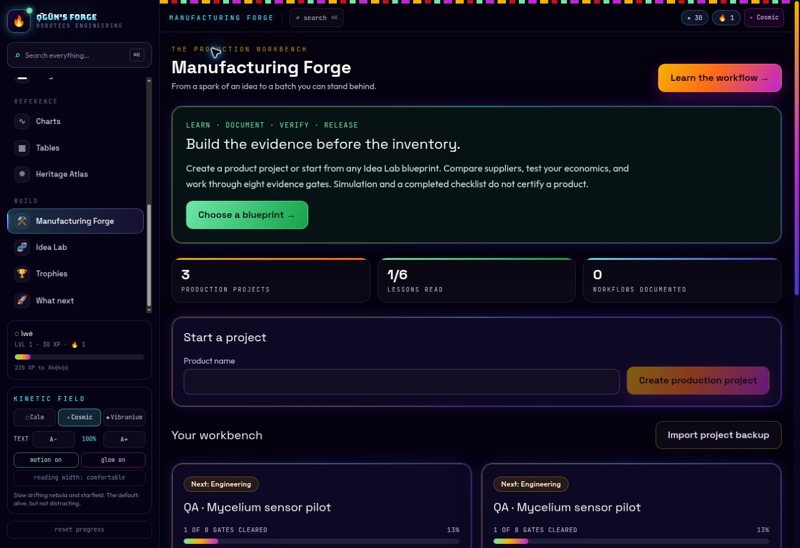

# Ọ̀GÚN'S FORGE — Robotics Engineering Academy

An interactive, gamified robotics engineering course in an **Afrocentric galactic psychedelic robotic** theme.
Built from an **8 weeks / 16 lessons** course outline, then pushed far past it: real solvers,
real 3D labs, and a large blueprint library fusing robotics with mycelium, biomimicry, Jyotish cultural
computing, exotic energy, quantum sensing and Afrofuturist systems.

> Iron is the ancestor of every circuit. Ọ̀gún's forge is open.

---

## What is in the app

| Section | What it does |
| --- | --- |
| **Course** (`/course`) | 8-week roadmap, 16 full lessons, per-lesson progress and boss-trial gates |
| **Lessons** (`/lesson/:id`) | Plain English panel, engineering text, KaTeX formulas, charts, reference tables, code and embedded 3D labs |
| **3D Labs** (`/labs`) | 10 interactive simulators running genuine mathematics (see below) |
| **Quiz Arena** (`/quiz`) | 7 questions per lesson, mixed drill, weak-spot drill, 8 weekly boss trials with a 25 s clock |
| **Flashcards** (`/flashcards`) | SM-2 style spaced repetition with ease factors, intervals and keyboard grading |
| **Charts** (`/charts`) | Personal analytics (mastery radar, XP/accuracy curves, per-lesson bars) plus every concept chart in the course |
| **Tables** (`/tables`) | 12 curated reference tables + every table authored inside lessons, searchable |
| **Idea Lab** (`/ideas`) | 88 buildable blueprints with BOM, steps, metrics, safety controls and honest reality splits |
| **Mycelium Tech** (`/mycelium`) | Living machines hub: grow protocol, substrate data, biosafety, the living-circuit lab and 24 mycelium blueprints |
| **Atlas** (`/atlas`) | 24 Afrocentric science and technology heritage entries with epistemic status labels, plus 5 design palettes |
| **Trophies** (`/achievements`) | 14 Adinkra badges and a 10-rank ladder from Ìwé to Ìmọ̀-Òrun |
| **Progress** (`/progress`) | Week-by-week completion, track mastery, 28-day activity heat map, and concrete next moves |
| **Glossary** (`/glossary`) | Every key term, alphabetised, searchable, linked to its lesson |

### The 10 labs (all run real mathematics)

`robot-arm` — planar 3R manipulator with forward kinematics, damped-least-squares inverse kinematics,
manipulability and a workspace point cloud.
`pid-drone` — quadrotor waypoint tracking with per-axis PID, saturation, drag, gust disturbance and an
analytic second-order step response.
`swarm` — 90 Reynolds boids with separation/alignment/cohesion, ring and grid formations and a predator mode.
`kalman` — 4-state Kalman filter fusing GNSS-like fixes with inertial dead reckoning, with bias, noise,
configurable fix rate and outage handling.
`mycelium` — space-colonisation growth of a hyphal network plus simulated action-potential-like spike
propagation and electrode recording.
`bloch` — single-qubit gate algebra (X, Y, Z, H, S, T, rotations), Bloch sphere, Born-rule measurement histograms.
`gear-train` — three-stage spur gear train with live ratios, mesh losses and reflected inertia.
`energy-field` — atmospheric, geothermal, radioisotope, solar and kinetic harvesting in honest orders of magnitude.
`vision-grid` — ground truth vs sensor view vs occupancy grid with beam width, noise, dropout and odometry drift.
`gait` — walk/trot/pace/bound gaits with IK-consistent legs, ZMP tracking and duty-factor stability.

---

## Stack

- **Vite 5** + **React 18** + **TypeScript** (strict)
- **Tailwind CSS 3** with a custom Afrocentric-galactic design system (`src/styles/globals.css`)
- **three.js** via **@react-three/fiber** + **@react-three/drei** for the 3D labs
- **Recharts** for charts, **KaTeX** for mathematics
- **Zustand** with `persist` for XP, streaks, quiz scores, flashcard scheduling and lab progress
- **framer-motion** for transitions

No backend. All progress lives in `localStorage` under `ogun-forge-progress-v1`.

---

## Local development

```bash
pnpm install
pnpm dev          # http://localhost:5173
pnpm build        # tsc -b && vite build  → dist/
pnpm preview      # serve the production build on :4173
pnpm typecheck    # tsc --noEmit
pnpm smoke        # server-renders all 34 routes and fails if any render throws
```

## Deployment

The repo ships a `vercel.json` that declares the Vite framework preset, the `dist` output directory and an
SPA rewrite to `index.html`, so client-side routes such as `/lesson/w4l8` resolve correctly.

```bash
vercel deploy --prod
```

---

## Content architecture

```
src/content/
  types.ts              # the content schema (Lesson, Block, IdeaProject, AtlasEntry, …)
  SCHEMA.md             # authoring contract for lesson files
  IDEAS_SCHEMA.md       # authoring contract for blueprint files
  bossAndTables.ts      # 8 weekly boss trials + 12 reference tables
  heritage.ts           # Heritage Atlas entries + design palettes
  lessons/w1l1.ts … w8l16.ts   # one file per lesson
  ideas/mycelium.ts, nature*.ts, jyotish-afrofuture.ts, energy-quantum.ts
  index.ts              # aggregation and derived collections
```

Every lesson is typed, every chart's data arrays must match its `x` axis length, and quiz `answer` indices
are validated by review — the schema is enforced by `tsc`.

---

## Honesty rules baked into the content

- **No magic materials.** Every Afrofuturist blueprint names the real material or mechanism standing in for
  the myth (auxetic lattices instead of vibranium, fractal antennas instead of yantra magic).
- **Reality splits.** Each blueprint separates *genuine engineering you can measure* from *cultural framing
  and narrative*.
- **Jyotish is cultural computing, not physics.** Astrology has no demonstrated predictive validity; the
  Jyotish projects compute real ephemerides and real agronomy, and say so.
- **Frontier energy is quantified.** Atmospheric harvesting is microwatts, not kilowatts, and the labs compute it.
- **Heritage entries carry epistemic status**: documented, archaeological, living tradition, or disputed
  (the Dogon/Sirius material is flagged disputed).
- **Biosafety and legal limits are stated** for spores, bacteria, radiation, UV, high voltage and mains.

---

## Credits

Course outline: 8 weeks, 16 lessons, hands-on builds, simulation, sensors, control systems, AI and perception, IoT, safety, industry insights,
teamwork, problem solving, automation, embedded systems, prototyping, real-world impact, future skills.

---

## Navigation and comfort (the vibranium pass)

- **Grouped sidebar** on desktop: Start here · Learn · Practise · Reference · Build. On a phone it becomes a
  five-tab bottom bar plus a full-height nav sheet, so nothing is more than two taps away.
- **Command palette** — press Cmd/Ctrl+K (or the `/` key) anywhere to search all 16 lessons, 10 labs,
  88 blueprints, 12 reference tables, 129 glossary terms, 24 heritage entries and 8 boss trials at once.
  Arrow keys move, Enter opens.
- **Deep links from search** land on the exact item: `/tables?t=sensor-selection` scrolls to and opens that
  table, `/atlas?e=<id>` does the same for a heritage entry.
- **Plain English panel** on every lesson: a jargon-free summary, an everyday analogy, the single sentence to
  remember, a checklist of what you can do afterwards, the most common beginner misconception, and where the
  material shows up in real products.
- **Glossary tooltips** — hover or keyboard-focus any key term (dashed underline) for its definition without
  leaving the page.
- **Reading comfort controls** — A+/A− scales every size in the app, a reading-width toggle switches between a
  comfortable 74-character column and full width, and the kinetic field has three levels: Calm (a still frame),
  Cosmic (slow drift) and Vibranium (full plasma, kaleidoscope mandala, growing hyphae, grain and scanlines).
  `prefers-reduced-motion` is honoured automatically on a first visit.
- **Sticky next-step bar** on lesson pages, so the next action is always visible while reading.

## The kinetic field

The background is a 2D canvas running three cheap layers: orbiting plasma blobs, a rotating k-fold mandala, and
mycelial hyphae that grow and carry travelling signal pulses, over a CSS nebula and drifting starfields. It is
capped at 1.5x device pixel ratio, pauses when the tab is hidden, and drops to a single static frame in Calm mode.

## Mycelium Tech (the advanced tier)

`/mycelium` is a dedicated hub for living-machine engineering: a grow → harden → instrument protocol with
go/no-go checks, an honest measured-versus-story split, six advanced concepts in plain language, substrate and
living-material reference tables, biosafety discipline, the living-circuit lab, and 24 mycelium blueprints
(including the advanced eight: mycelial reservoir computing, myco-silicon hybrid tactile skin, a tensegrity
field habitat, a self-replicating construction swarm, melanised radiation shielding, magnetite-bearing magnetic
sensing, mycoremediation, and a graded phononic vibration metamaterial).

---

## Verification

`pnpm build` runs `tsc --noEmit` (strict, zero errors) followed by the Vite production build, which
reports no circular chunks. `pnpm smoke` builds a development-only SSR entry (`ssr-smoke.tsx`) and
server-renders every route — all 34 currently pass — which catches component-tree errors that a
type-check cannot, such as a React Three Fiber hook called outside `<Canvas>`.

Content inventory at time of writing: 16 lessons, 112 lesson quiz questions, 8 boss trials with 80
questions, 155 flashcards, 129 key terms, 12 curated reference tables, 88 Idea Lab blueprints, 24
Heritage Atlas entries, 10 labs, 14 badges.

## Manufacturing Forge — blueprint to batch



The manufacturing expansion adds an applied companion track without changing the original 8-week robotics curriculum.

- `/manufacturing` — create production projects, import validated JSON backups, reopen saved projects and export records.
- `/manufacturing/learn` — six lessons (120 minutes), 18 explained quiz questions and 18 revealable glossary flashcards. Lesson-read status and best quiz scores persist independently of the core robotics course.
- `/manufacturing/project/:productionId` — eight sequential evidence gates, supplier qualification and comparable quote records, USD landed-cost/contribution modeling, and dated milestone payment records.
- Every Idea Lab blueprint can start a production project with its brief, engineering reality, safety considerations and BOM copied across. An existing linked project opens instead of duplicating it.
- Sidebar, mobile navigation sheet, footer and command search include the manufacturing track.

### Try the complete flow

1. Open an Idea Lab blueprint and choose **Start production project**.
2. Review the copied brief/BOM; document demand evidence, reviewer and review date.
3. Add suppliers with scope, qualification evidence and comparable quotes. Select a partner; explicitly copy its quoted price into the cost scenario if desired.
4. Enter only additional costs outside the quote. Record origin, destination, classification and broker/date evidence for duty assumptions.
5. Complete each gate's checks and evidence. Later gates can be prepared early, but clearance depends on every earlier gate. Removing upstream evidence reopens the sequence.
6. Set dated milestone percentages totaling 100%, then record release evidence before marking a payment as paid. Changing goods price or order quantity clears paid flags so old records cannot silently imply payment of a new invoice amount.
7. Download a draft RFQ and export a JSON backup. Import creates a new project with a fresh identity, preserving existing projects.

### Calculation contract

All money inputs use USD. `repeat landed/unit = quoted unit price + additional packaging + additional transport/insurance + additional duties/taxes + additional batch fees / quantity`.

First-run cash includes repeat landed cost times quantity, tooling/NRE and one-time testing. The contingency is applied to that total. Gross margin excludes variable selling expenses; contribution deducts them. Break-even units recover only one-time setup/testing and are unavailable at non-positive contribution. The tool does not determine HTS classification, customs value, applicable duty rates or tax treatment. DDP inclusions must be confirmed to prevent double-counting.

Payment percentages apply to quoted goods value only. Other costs require separate funding. These are planning and recording tools: they do not contact suppliers, inspect hardware, certify products, place orders, transfer money, or guarantee supplier credit.

### Source and data boundaries

Teaching content is an original adaptation of the supplied manufacturing transcript. It corrects oversimplifications about OEM/ODM, tooling versus NRE, AQL, radio modules, CE marking and price/margin calculations. Tariff percentages and holiday dates from the transcript are not hard-coded. Official CBP, USITC, Trade.gov, FCC, European Commission, SINOSURE and WIPO reference links are included in the Academy; product-specific requirements still need review at the time of a real decision.

Project records, read status and scores use the versioned `ogun-manufacturing-v1` browser storage key. They are local to this browser, with no server sync or authentication. Export backups for portability; use references to sensitive CAD/contracts rather than pasting confidential files. The import accepts version-1 project backups under 2 MB and validates known fields, numbers, dates, supplier references and gate check IDs. Manufacturing flashcards are simple reveal cards; the existing robotics spaced-repetition deck remains separate.

### Verification

```bash
pnpm build
pnpm smoke                 # 47 route renders, including all new lessons and a populated workspace fixture
pnpm test:manufacturing    # cost math, sequential gates, payment allocation, imports and invoice changes
```

`pnpm-workspace.yaml` carries the esbuild approval for current pnpm; the existing package-level setting is retained for older pnpm versions. No new runtime dependencies were added.

## Kamitron integration

Ogun Forge now includes Kamitron's living technology departments, 35-specimen 3D Vault, services, community, series, history, contact and waitlist. Start at `/kamitron` or `/vault`. See [the integration guide](docs/KAMITRON_INTEGRATION.md) for the route map, GLB model setup, email environment variables and validation commands.
